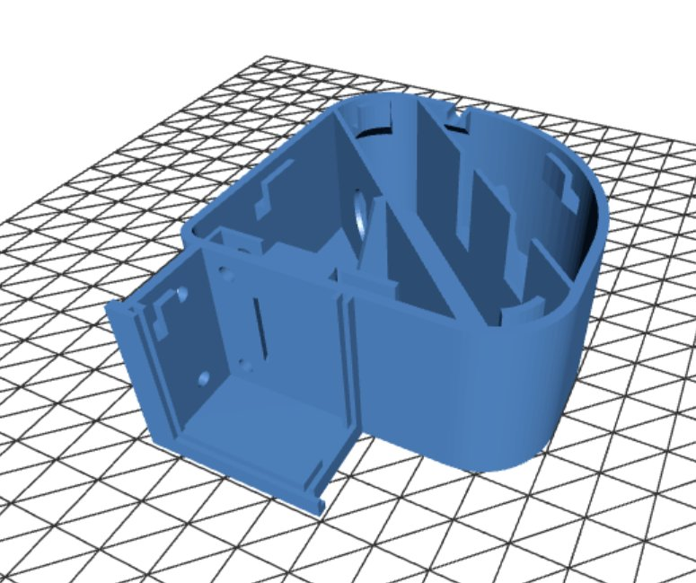

# Spectral-Explorer

*Sprache: [English](README.md) | Deutsch*

**Spectral-Explorer** ist ein USB-basiertes optisches Spektrometer mit zugehöriger Qt/C++-Desktop-Software für den naturwissenschaftlichen Unterricht (Physik, Chemie und Biologie) sowie für Hobby- und Laborexperimente. Das Projekt wurde beim 50. Bundeswettbewerb *Jugend forscht* mit einem Sonderpreis ausgezeichnet und ermöglicht präzise spektrale Messungen ohne teure Laborgeräte.

Weitere Informationen zur Hardware und zum Projekthintergrund finden Sie auf [spectral-explorer.de](https://spectral-explorer.de/).

  

## Überblick

* **Messbereich:** 400–650 nm (sichtbares Spektrum)
* **Wellenlängenauflösung:** Bis zu 1 nm
* **Verstellbarer optischer Spalt:** Fein einstellbar für unterschiedliche Lichtintensitäten und Lichtquellen
* **USB-Anschluss:** Verwendet eine Standard-USB-Webcam (Logitech C270) — ideal für Lehrer-Demonstrationen über Beamer oder Schülerexperimente
* **Erweiterbare Hardware:** Optionaler Küvettenhalter für Absorptions- und Transmissionsmessungen an Flüssigkeiten sowie integriertes 1/4″-Stativgewinde
* **3D-druckbares Gehäuse & Küvettenhalter:** STL-Dateien, FreeCAD-Quelldateien und Druckprofile liegen unter [`hardware/case/`](hardware/case/) und [`hardware/cuvette_holder/`](hardware/cuvette_holder/), die Schritt-für-Schritt-Bauanleitung unter [`hardware/assembly_instructions.de.md`](hardware/assembly_instructions.de.md)
* **Bedienungsanleitung:** Sicherheitshinweise, Spalteinstellung, CFL-Wellenlängenkalibrierung und Software-Bedienung sind in [`docs/user_guide.de.md`](docs/user_guide.de.md) beschrieben

## Anwendungsbeispiele

Spectral-Explorer eignet sich für zahlreiche Experimente in Physik, Chemie und Biologie (siehe [spectral-explorer.de/kategorie/experimente](https://spectral-explorer.de/kategorie/experimente/)):

* **Flammenspektroskopie** — Elemente anhand ihrer charakteristischen Emissionslinien identifizieren.
* **Fraunhoferlinien** — Absorptionslinien im Sonnenspektrum beobachten.
* **Leuchtstofflampen-Spektren** — Diskrete Gasentladungs-Emissionslinien analysieren (auch zur Kalibrierung bei 436 nm / 611 nm).
* **Indikatorfärbung (Rotkohlsaft)** — pH-abhängige Absorptionsverschiebungen mit dem Küvettenhalter messen.
* **Unterscheidung von Säften** — Absorptionsspektren verschiedener Flüssigkeitsproben vergleichen.

  
  &nbsp;
  

  
  &nbsp;
  

## Software-Funktionen

* Live-Kamerabild und Echtzeit-Spektralerfassung
* Optische Ansicht und Intensitätsdiagramm
* Vergleich mehrerer Spektren mit automatischem Farbwechsel
* Rauschunterdrückung / einstellbare Filterstufe
* Wellenlängenkalibrierung anhand von Leuchtstofflampen-Linien (436 nm und 611 nm)
* Speichern, Laden und Exportieren von Spektraldaten (CSV) und Bildern (PNG)

## Download & Installation (Windows)

Vorkompilierte Programme finden Sie auf der Seite [GitHub Releases](https://github.com/lhoyer/spectral-explorer/releases) — eine Installation von Qt oder OpenCV ist dafür nicht erforderlich:

* **Windows-Installationsprogramm (empfohlen):** Laden Sie `Spectral-Explorer-<version>-Setup.exe` herunter und führen Sie es aus, um das Programm inkl. Startmenü-/Desktop-Verknüpfung zu installieren.
* **Portable ZIP-Version (ohne Admin-Rechte):** Laden Sie `Spectral-Explorer-<version>-portable.zip` herunter, entpacken Sie alle Dateien in einen beliebigen Ordner und starten Sie `Spectral-Explorer.exe`.

**Nächste Schritte:** Lesen Sie die **[Bedienungsanleitung](docs/user_guide.de.md)** für Sicherheitshinweise, Spalteinstellung, CFL-Wellenlängenkalibrierung (436 nm / 611 nm) und Software-Bedienung.

## Hardware

**Selbst bauen?** Das Spektrometer nutzt ein 3D-gedrucktes, mattschwarzes Gehäuse für einen kostengünstigen, reproduzierbaren Nachbau. Folgen Sie der **[Hardware-Bauanleitung](hardware/assembly_instructions.de.md)**; alle `.stl`-Meshes, FreeCAD-Quelldateien (`.FCStd`) und Druckprofile (`.ini`) finden Sie in [`hardware/case/`](hardware/case/) und [`hardware/cuvette_holder/`](hardware/cuvette_holder/).

* **Gehäuse & Deckel:** Hauptgehäuse ([`case.stl`](hardware/case/case.stl)), Deckel ([`cap.stl`](hardware/case/cap.stl)), Abdeckplatten ([`plate_front.stl`](hardware/case/plate_front.stl), [`plate_right.stl`](hardware/case/plate_right.stl)) und interner Mutternhalter ([`nut_holder.stl`](hardware/case/nut_holder.stl)) — in mattem Schwarz gedruckt, um interne Reflexionen zu minimieren.
* **Optischer Spalt:** Zwei Rasierklingen-Hälften — eine fest verschraubte linke Hälfte ([`aperture.stl`](hardware/case/aperture.stl)) und eine magnetisch gehaltene rechte Hälfte ([`aperture_magnet.stl`](hardware/case/aperture_magnet.stl)) — über Rändelmuttern fein einstellbar.
* **Optisches Gitter:** Ein kleines Stück aus einer Standard-DVD-R/DVD+R zerlegt das einfallende Licht in sein Spektrum.
* **Sensor:** Eine modifizierte **Logitech C270** USB-Webcam (Fokus manuell angepasst, Status-LED abgedeckt/ausgelötet) nimmt das Spektrum auf.
* **Küvettenhalter (optional):** Ein aufsteckbarer [`cuvette_holder.stl`](hardware/cuvette_holder/cuvette_holder.stl) mit Kappe ([`cuvette_cap.stl`](hardware/cuvette_holder/cuvette_cap.stl)) ermöglicht Absorptions- und Transmissionsmessungen an Flüssigkeiten.
* **Stativbefestigung:** Integriertes 1/4″-Stativgewinde ([`tripod_nut_cover.stl`](hardware/case/tripod_nut_cover.stl)).

  

## Aus dem Quellcode kompilieren (Entwickler)

*Normale Anwender benötigen diesen Abschnitt nicht — nutzen Sie einfach das fertige Installationsprogramm oder die portable ZIP-Datei unter [Download & Installation (Windows)](#download--installation-windows).*

Die detaillierten englischen Build-, Deployment-, Paketierungs- und Test-Anleitungen (Qt 5.11.3 MinGW 32-bit & OpenCV 2.4.13) finden Sie in [`README.md`](README.md#building-from-source-developers).

## Lizenz

Dieses Projekt steht unter der Lizenz [Creative Commons Attribution-NonCommercial-ShareAlike 4.0 International (CC BY-NC-SA 4.0)](LICENSE) — frei für nicht-kommerzielle Nutzung bei Namensnennung und Weitergabe unter gleichen Bedingungen.
