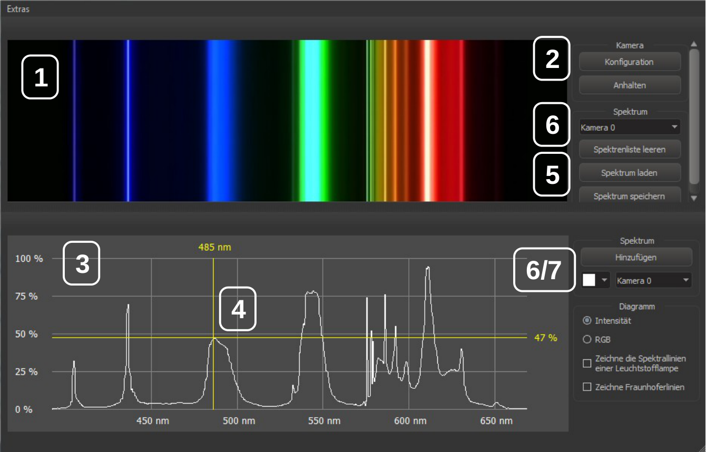
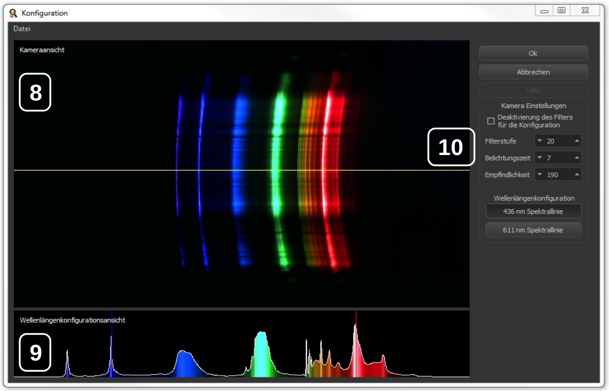

# Spectral-Explorer Bedienungsanleitung

> **Sprache:** [English](user_guide.md) | Deutsch

## Sicherheitshinweise

* **Starke Magnete:** Im Gerät sind starke Magnete verbaut. Halten Sie ausreichend Abstand zu anderen magnetischen Gegenständen (Quetschungsgefahr) sowie zu empfindlichen Geräten und Gegenständen wie Herzschrittmachern, EC-Karten, mechanischen Uhren und Festplatten.
* **Hitze & Umgebung:** Hohe Temperaturen können die Magnete entmagnetisieren, die Elektronik überhitzen und die Formstabilität des 3D-gedruckten Gehäuses beeinträchtigen. Halten Sie ausreichend Abstand zu Wärmequellen (z. B. Glühlampen, Brennerflammen) und betreiben Sie das Gerät nur in trockenen Innenräumen.
* **Empfindlicher Spalt:** Gehen Sie vorsichtig mit dem Gerät um. Vermeiden Sie Stöße und Stürze, beschädigen Sie die Rasierklingen-Spaltöffnung nicht und **versuchen Sie nicht, den Spalt mit den Rändelmuttern mit Gewalt vollständig zu schließen**.

---

## Empfohlenes Vorgehen beim Spektroskopieren

### 1. Hinweise zum Verstellen des Spalts mit Rändelmuttern

* Verstellen Sie den Spalt nur, während Sie in der **Kameraansicht** des Fensters **Konfiguration** das Spektrum einer Lichtquelle beobachten können.
* Verstellen Sie **beide Rändelmuttern möglichst gleichmäßig**, sodass der Spalt parallel bleibt.
* Schließen Sie den Spalt niemals mit Gewalt vollständig, da sonst die Spaltblenden beschädigt werden können.

### 2. Positionierung & Ausrichtung

1. Öffnen Sie den Spalt leicht.
2. Richten Sie Spectral-Explorer mittig auf die Lichtquelle oder die durchstrahlte Probe aus (mit ausreichendem Abstand zu heißen Lichtquellen).
3. Öffnen Sie **Konfiguration** im Hauptfenster und prüfen Sie die **Kameraansicht**: Wenn die höchste Lichtintensität nicht in der vertikalen Mitte liegt, justieren Sie den Aufbau entsprechend nach.

### 3. Spaltbreite, Belichtungszeit & Empfindlichkeit

1. Setzen Sie in **Konfiguration** die **Belichtungszeit** und **Empfindlichkeit** zunächst auf höhere Stufen.
2. Schließen Sie den Spalt schrittweise über die Rändelmuttern, bis die Kamera nicht mehr übersteuert — d. h. **keine rein weißen Bereiche** mehr im Spektrum zu sehen sind.
   * **Engerer Spalt:** Höhere spektrale Auflösung (schärfere Linien).
   * **Breiterer Spalt:** Mehr Licht; wenn keine hohe Auflösung benötigt wird, können Sie den Spalt breiter lassen und stattdessen **Belichtungszeit** und **Empfindlichkeit** reduzieren.
3. Klicken Sie in die **Kameraansicht**, um die **gelbe Konfigurationslinie** auf eine der **mittleren Kamerazeilen** zu setzen, da das Spektrum dort am schärfsten abgebildet wird.

### 4. Wellenlängenkalibrierung (Leuchtstofflampe)

1. Richten Sie das Spektrometer auf eine normale **Leuchtstofflampe / Energiesparlampe**.
2. In der **Wellenlängenkonfigurationsansicht** (unten in **Konfiguration**):
   * Aktivieren Sie **436 nm Spektrallinie** und klicken Sie auf die **mittlere blaue Spektrallinie**, um die blaue Konfigurationslinie zu setzen.
   * Aktivieren Sie **611 nm Spektrallinie** und klicken Sie auf die **hellste rote Spektrallinie**, um die rote Konfigurationslinie zu setzen.
3. Klicken Sie auf **Ok**, um die Kalibrierung zu übernehmen und zu speichern.

---

## Software-Übersicht

### Hauptansicht

1. **Optische Ansicht:** Stellt die Spektren als Farbverlauf dar. Neue Messdaten werden oben hinzugefügt und schieben ältere nach unten. Weiße Bereiche deuten auf eine Überbelichtung hin.
2. **Konfiguration:** Öffnet das Konfigurationsfenster (siehe unten).
3. **Diagrammansicht:** Stellt die Spektren als Intensitäts- oder RGB-Graph dar.
4. **Messkreuz:** Bewegen Sie den Mauszeiger über das Diagramm, um Wellenlänge und Intensität abzulesen; Linksklick setzt einen Messpunkt, Rechtsklick entfernt ihn.
5. **Spektrenverwaltung:** Messung anhalten (**Anhalten**), gemessene Spektren speichern (inkl. `.config`), gespeicherte Spektren laden oder die Liste virtueller Spektren leeren.
6. **Spektrenauswahl:** Wählt das Spektrum aus, das in der optischen bzw. Diagramm-Ansicht gezeigt wird.
7. **Spektrum hinzufügen (`Hinzufügen`):** Fügt weitere Spektren-Auswahlzeilen hinzu, um mehrere Spektren farblich unterscheidbar im selben Diagramm zu vergleichen.

*(Über **Export** lassen sich die Rohdaten als `.csv` oder die Diagramm-/optische Ansicht als `.png` exportieren.)*

### Konfigurationsansicht

8. **Kameraansicht:** Zeigt alle Kamerazeilen an. Per Klick positionieren Sie die gelbe Linie für die ausgewählte Zeile (möglichst mittig).
9. **Wellenlängenkonfigurationsansicht:** Interaktive 436 nm / 611 nm Kalibrierung anhand einer Leuchtstofflampe.
10. **Kameraeinstellungen:**
    * **Filterstufe:** Höhere Werte verringern das Messrauschen, verzögern aber die Reaktion. Bei geöffneter Konfiguration ist die Filterung standardmäßig deaktiviert, damit Änderungen sofort sichtbar sind (*Deaktivierung des Filters für die Konfiguration*).
    * **Belichtungszeit:** Höhere Werte hellen das Spektrum auf, erhöhen aber die Aufnahmezeit pro Bild.
    * **Empfindlichkeit (Gain):** Verstärkt die Sensorhelligkeit ohne längere Aufnahmezeit.
