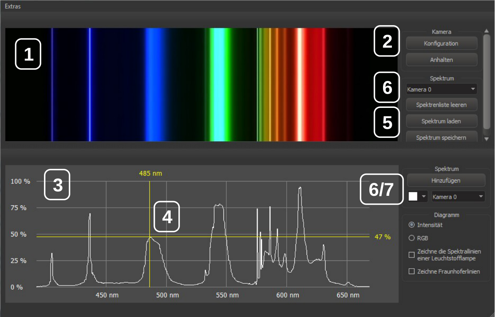
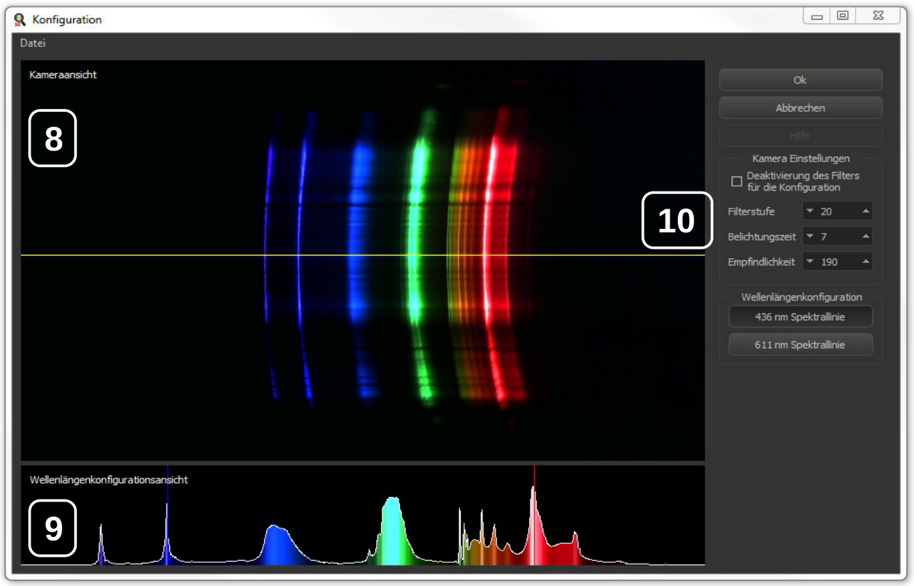

# Spectral-Explorer User Guide

> **Language:** English | [Deutsch](user_guide.de.md)

## Safety Notes

* **Strong magnets:** The adjustable slit uses strong magnets. Keep them away from other magnets (pinching hazard) and magnetic-sensitive items such as pacemakers, credit/debit cards, mechanical watches, and hard drives.
* **Heat & environment:** High temperatures can demagnetize the magnets, overheat the camera electronics, and deform the 3D-printed housing. Keep sufficient distance from hot light sources (incandescent bulbs, burner flames) and operate only in dry indoor environments.
* **Delicate slit edges:** Handle the spectrometer carefully. Avoid impacts or drops, never nick the razor-blade slit edges, and **never force the slit completely shut** with the knurled nuts.

---

## Recommended Measurement Workflow

### 1. Adjusting the Slit with the Knurled Nuts

* Only adjust the slit while monitoring the live **Camera View** in the **Configure** dialog.
* Turn **both knurled nuts evenly** so the slit remains parallel.
* Never force the slit completely closed, as this can damage the razor-blade edges.

### 2. Positioning & Alignment

1. Open the slit slightly.
2. Aim the spectrometer centrally at the light source or illuminated sample (keeping safe distance from hot sources).
3. Open **Configure** from the main window and inspect the **Camera View**: if the brightest band is not near the vertical center, adjust your physical setup until the light falls onto the middle of the slit.

### 3. Slit Width, Exposure & Gain

1. In **Configure**, set **Exposure** and **Gain** to higher values initially.
2. Gradually close the slit using the knurled nuts until the camera is no longer overexposed—i.e., **no pure white areas** appear in the spectrum.
   * **Narrower slit:** Higher spectral resolution (sharper lines).
   * **Wider slit:** More light; if high resolution is not needed, you can keep the slit wider and reduce **Exposure** and **Gain** instead.
3. Click in the **Camera View** to position the **yellow configuration line** on one of the **middle camera rows**, where the spectrum is sharpest.

### 4. Wavelength Calibration (Fluorescent / CFL Lamp)

1. Point the spectrometer at a standard **compact fluorescent lamp (CFL)**.
2. In the **Wavelength Config View** (bottom of **Configure**):
   * Select **436 nm Spectral Line** and click on the **middle blue spectral line** to position the blue calibration line.
   * Select **611 nm Spectral Line** and click on the **brightest red spectral line** to position the red calibration line.
3. Click **Ok** to apply and save the calibration.

---

## Software Overview

### Main Window

1. **Optical View:** Displays the spectrum as a color strip. New measurements enter at the top and scroll downward. Pure white regions indicate overexposure.
2. **Configure (`Konfiguration`):** Opens the Configuration Dialog (see below).
3. **Graph View:** Plots intensity vs. wavelength (or RGB channels).
4. **Measurement Crosshair:** Move the mouse over the graph to read exact wavelength and intensity values; left-click to place a measurement marker, right-click to remove it.
5. **Spectrum Management (`Spektrenverwaltung`):** Freeze (`Anhalten`), save measured spectra (with `.config`), load previously saved spectra, or clear the virtual spectrum list.
6. **Spectrum Selector:** Choose which live or loaded spectrum is displayed in the optical or graph view.
7. **Add Spectrum (`Hinzufügen`):** Add additional spectrum selectors to compare multiple saved or live spectra in the same graph with distinct colors.

*(You can also click **Export** to save raw spectrum data as `.csv` or export the graph/optical view as a `.png` image.)*

### Configuration Dialog

8. **Camera View:** Displays all camera rows. Click to position the yellow active-row line (use one of the middle rows for the sharpest spectrum).
9. **Wavelength Config View:** Interactive 436 nm / 611 nm calibration against a CFL spectrum.
10. **Camera Settings:**
    * **Filter Level (`Filterstufe`):** Higher values reduce noise at the cost of slower response. Filtering is disabled by default while **Configure** is open so slit/focus changes are visible immediately (controlled by *Disable Filter for Configuration*).
    * **Exposure (`Belichtungszeit`):** Higher values brighten the spectrum but increase frame capture time.
    * **Gain (`Empfindlichkeit`):** Amplifies sensor brightness without increasing capture time.
